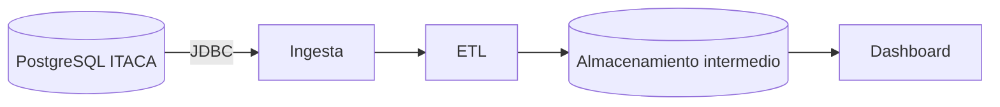

# Proyecto 2 · Analítica académica ITACA (relacional)

> Análisis de datos académicos a partir de una base de datos PostgreSQL (réplica de ITACA) vía JDBC.

## Descripción y objetivo

El mismo objetivo que el [Proyecto 1](https://github.com/jorgeestebandam/bigdata-p1-itaca), pero partiendo de una base de datos **PostgreSQL** (réplica de **ITACA**) accedida mediante **JDBC**, en lugar de ficheros XML.

Se mantiene el mismo modelo de datos (alumnado, cursos, módulos y calificaciones) y el mismo dashboard final. Cambian el origen de los datos y el almacenamiento intermedio.

> [!NOTE]
> Los datos de alumnado deben estar siempre anonimizados.

## Arquitectura

*Diagrama provisional del Bloque 0. Se actualizará al terminar cada bloque.*

## Fuentes de datos

| Fuente | URL / origen | Formato | Frecuencia de actualización | Licencia | Última ingesta |
|---|---|---|---|---|---|
| Réplica PostgreSQL de ITACA | Conexión JDBC | Base de datos relacional | Pendiente | Pendiente | Pendiente |

## Estructura del repositorio

| Carpeta | Contenido |
|---|---|
| `ingesta/` | Extracción de datos desde PostgreSQL mediante JDBC |
| `etl/` | Transformación, limpieza y carga en el almacenamiento intermedio |
| `dashboard/` | Visualización y análisis de los datos |
| `docs/` | Capturas y diagramas |

## Cómo desplegar el entorno

Pendiente de completar cuando se defina la conexión a PostgreSQL y el almacenamiento intermedio.

## Bitácora de prácticas

### [Bloque 0 · Entorno ](./documentacion/bloque_0.md)
### [Bloque 1 · Ingesta de datos ](./documentacion/bloque_1.md)

## Equipo

- Jorge Esteban García